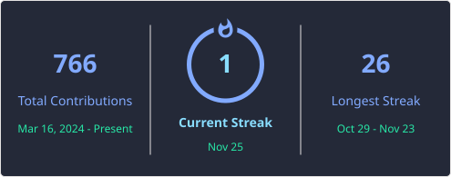

# Zaheer Ahmed

**Generative AI / ML Engineer · Full-Stack Developer**

Calais, France 

I build LLM-powered applications and the backend services around them: multi-agent systems, retrieval pipelines (RAG), and cloud-ready APIs.

## Featured projects

| Project | Description | Stack |
|---|---|---|
| [Explainable-Medication-Recommender](https://github.com/zaheer-ahmed-git/explainable-medication-recommender) | Explainable medication recommendation research pipeline with clinical-style top-k evaluation | Python, pytest |
| [RAG-Powered-Knowledge-Base](https://github.com/zaheer-ahmed-git/RAG-Powered-Knowledge-Base) | Hybrid retrieval (FAISS + BM25, RRF fusion, MMR reranking), knowledge-graph context, grounded answers | LlamaIndex, FAISS, LangChain, FastAPI |
| [LLM-Travel-Argumentation-Agent](https://github.com/zaheer-ahmed-git/LLM-Travel-Argumentation-Agent) | Multi-agent workflow automation with a custom orchestration layer and a quality-control gate | OpenAI Agents SDK, FastAPI, PostgreSQL |
| [RealtimeCallSemanticAnalysis](https://github.com/zaheer-ahmed-git/RealtimeCallSemanticAnalysis) | Call-center analysis combining audio emotion and text sentiment to predict sale probability | Python, wav2vec2, Pyannote |
| [Public_Housing_Maintenance_ML](https://github.com/zaheer-ahmed-git/Public_Housing_Maintenance_ML) | Maintenance cost estimation and high-cost prioritisation on audited public housing data | Python, XGBoost, Streamlit |
| [ZAHEER-MART-API](https://github.com/zaheer-ahmed-git/ZAHEER-MART-API) | Microservices e-commerce backend with six FastAPI services, Kafka events, Kong gateway and Stripe payments | FastAPI, Kafka, Kong, Docker Compose |
| [Portfolio](https://github.com/zaheer-ahmed-git/Portfolio) | Personal portfolio website | TypeScript |

## Skills

**AI and Machine Learning**

**Backend and Data**

**Frontend**

**Cloud and DevOps**

Agentic AI · Multi-Agent Systems · RAG · Hybrid Search · Knowledge Graphs · NLP · Speech Processing · Explainable AI · Computer Vision · Microservices · Event-Driven Architecture · REST APIs · API Gateway · Stripe Payments · Docker Compose · Pytest

## GitHub activity

<!-- Static SVGs refreshed daily by .github/workflows/update-readme-cards.yml (no public CDN cache). -->

  

